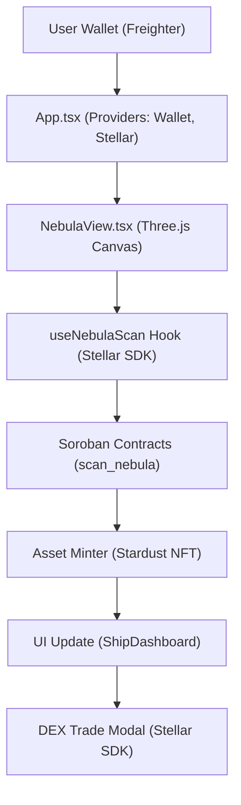

# Nebula Nomad Frontend

**Nebula Nomad: On-Chain Space Exploration Sim** – The frontend for a serene, decentralized space exploration game on the Stellar blockchain. Drift through procedurally generated nebulae, harvest stardust resources as Stellar assets, and upgrade your NFT ship in a chill, combat-free experience. Built with React, TypeScript, Vite, Stellar SDK, and Three.js for immersive, mobile-first visuals.

This repo powers the web app interface, connecting to the [backend smart contracts](https://github.com/Space-Nebula/stellar-nebula-nomad) via Soroban. It's designed for seamless Web3 integration: wallet connects, real-time txns, and on-chain procedural generation seeded by Stellar ledgers for fair, verifiable exploration.

## Overview

Nebula Nomad reimagines Web3 gaming as relaxing discovery. No grinding or PvP — just captain your customizable spaceship (NFT modules), scan cosmic anomalies for loot, and trade on Stellar's DEX. Key innovations:

- **Ledger-Seeded Procedural Gen**: Nebula layouts and rarity use Stellar transaction hashes as RNG seeds — transparent and tamper-proof.
- **Micro-Transaction Economy**: Harvest costs 0.01 XLM; upgrades burn resources for yields. All on-chain for true ownership.
- **Modern Stack**: React 19 for dynamic UI, Three.js (via React Three Fiber) for particle-based nebulae, Zustand for state, Stellar SDK for blockchain ops.

This frontend demonstrates Stellar's low-latency for real-time gaming, targeting crypto newcomers with short, approachable sessions. Part of [Space-Nebula](https://github.com/Space-Nebula). See [docs/ROADMAP.md](docs/ROADMAP.md) for where the project is headed.

[Backend Repo](https://github.com/Space-Nebula/stellar-nebula-nomad)

For the full, up-to-date feature list see [docs/FEATURES.md](docs/FEATURES.md). Highlights:

## Features

- **Wallet Integration**: Connect via Freighter or Albedo, with Ledger hardware wallet support ([Hardware Wallet Guide](docs/HARDWARE_WALLETS.md)) and multi-signature transaction flows; sign txns for scans/upgrades.
- **Immersive Nebula View**: Three.js canvas renders procedural clouds with interactive scanning (click to harvest), seeded by Stellar transaction hashes.
- **Ship Dashboard**: Real-time stats, asset viewer for NFTs/resources, upgrade flows with transaction previews.
- **Marketplace**: On-chain order book DEX interface for trading harvested resources (`DEXInterface`, `OrderBook`, `TradeForm`).
- **Responsive Design**: Mobile-first (Tailwind CSS), dark mode, haptic feedback on scans and upgrades.
- **Contract Hooks**: `useNebulaScan` and `useShipUpgrade` wrap `scan_nebula`/`upgrade_ship` contract calls with loading/error handling.
- **Testing & Accessibility**: Vitest + Testing Library for unit/component tests, Playwright for E2E, ARIA-compliant components for Web3 UX.

## Quick Start

### Prerequisites

- Node.js 18+ and npm/yarn.
- Stellar testnet wallet (e.g., Freighter browser extension).
- Funded Futurenet account (get test XLM at [lab.stellar.org](https://lab.stellar.org)).

### Setup

1. Clone the repo:

   ```bash
   git clone https://github.com/Space-Nebula/stellar-nebula-frontend.git
   cd stellar-nebula-frontend
   ```

2. Install dependencies:

   ```bash
   npm install
   ```

3. Run the dev server:

   ```bash
   npm run dev
   ```

   Open [http://localhost:5173](http://localhost:5173) – connect your wallet and scan a nebula!

## Docker

You can also run the project using Docker for a consistent development environment:

### Development

```bash
npm run docker:dev
```

This will start the development server with hot reloading at `http://localhost:5173`.

### Production Build

```bash
npm run docker:build
npm run docker:prod
```

This will build and serve the production version at `http://localhost:8080`.

## Storybook

We use Storybook to document and develop our UI components in isolation.

To start Storybook:

```bash
npm run storybook
```

To build Storybook for deployment:

```bash
npm run build-storybook
```

### Local Testing with Backend

- Deploy backend contracts to Futurenet (see [backend README](https://github.com/Space-Nebula/stellar-nebula-nomad)).
- Point the frontend at your contract IDs via the environment variables in [docs/ENVIRONMENT.md](docs/ENVIRONMENT.md).
- Mock txns in tests with MSW for offline dev.

## Architecture

High-level flow: User → Wallet Connect → Scan Button → Hook Calls Contract → Three.js Animates Loot → DEX Trade UI.



- **Providers**: Wraps the app with context providers for wallet and Stellar network config.
- **State Management**: Zustand for lightweight ship/resources state (off-chain cache).
- **Error Boundaries**: Catches txn failures with user-friendly toasts.

See [docs/ARCHITECTURE.md](docs/ARCHITECTURE.md), [docs/STATE_MANAGEMENT.md](docs/STATE_MANAGEMENT.md), and [docs/DATA_FLOW.md](docs/DATA_FLOW.md) for the full architecture deep-dive.

### Building

```bash
npm run build # Outputs to /dist
```

### Testing

- **Unit**: `npm test` (Vitest + React Testing Library).
- **Performance**: `npm run performance:test` (FPS and memory regression coverage), `npm run performance:ci` (Lighthouse CI with budget enforcement).
- **E2E**: `npm run test:e2e` (Playwright, see `e2e/`).
- **Lint**: `npm run lint` (ESLint + Prettier).

#### Performance Testing

See [docs/performance-testing.md](docs/performance-testing.md) for thresholds, local commands, and Lighthouse report interpretation.

### Deployment

- **Vercel**: Connected via `vercel.json`; pushes to `main` deploy automatically.
- **Docker**: See the [Docker](#docker) section above for a self-hosted production build.

## Environment Variables

Configuration is handled via Vite environment variables. See [docs/ENVIRONMENT.md](docs/ENVIRONMENT.md) for full documentation of all variables, defaults, and requirements.

Quick start:

```bash
cp .env.example .env.local
```

## Troubleshooting & FAQ

Encountering issues with setup, wallet connections, or transactions?

- [Troubleshooting Guide](docs/TROUBLESHOOTING.md) — Comprehensive guide for wallet, transaction, and rendering issues
- [Frequently Asked Questions (FAQ)](docs/FAQ.md) — Common developer questions and concepts
- [Common Errors and Solutions](docs/COMMON_ERRORS.md) — Fast lookups for error messages and fixes

## Contributing
## Security

Found a vulnerability? Please report it privately via a
[GitHub Security Advisory](https://github.com/Space-Nebula/stellar-nebula-frontend/security/advisories/new)
rather than a public issue. Contact details also live at `/.well-known/security.txt`
([RFC 9116](https://www.rfc-editor.org/rfc/rfc9116)). See [docs/SECURITY.md](docs/SECURITY.md) for
the full security review and policy.

Contributing
We welcome contributions! Fork, branch (feat/your-feature), and submit PRs.

We welcome contributions! Fork the repo, branch from `main` (`feat/your-feature`, `fix/bug-name`, `docs/your-doc`), and submit a PR.

- **Issues**: Use the provided templates for bugs/features. Look for the `good-first-issue` label if you're new.
- **Commits**: Conventional style preferred (e.g. `feat: add scan animation`).
- **Reviews**: At least one approval and passing CI checks before merge.

See [CONTRIBUTING.md](CONTRIBUTING.md) for full setup, workflow, and contract-integration guidelines.

### Code of Conduct

This project adheres to the Contributor Covenant Code of Conduct. By participating, you agree to uphold it — see [docs/CODE_OF_CONDUCT.md](docs/CODE_OF_CONDUCT.md) for the full text and how to report issues.

### License

This project has not yet declared an open-source license. Treat the code as all-rights-reserved until a `LICENSE` file is added.

## Acknowledgments

- **Stellar Team**: For Soroban and the SDK powering fair on-chain gaming.
- **Open-Source Deps**: React, Three.js, Stellar SDK — thanks to all maintainers.
- **Inspiration**: _No Man's Sky_–style procedural exploration, reimagined as blockchain-native.

## Recent Changes

See [CHANGELOG.md](CHANGELOG.md) for the full, versioned list of changes.
