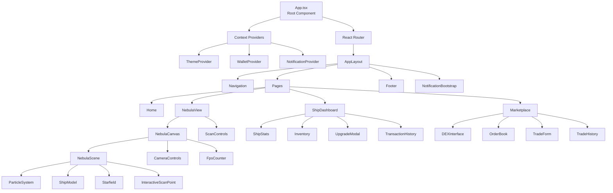

# Component Hierarchy

React component tree from the root `App.tsx` down through routing, layout, and
the three main feature areas: the nebula canvas, the ship dashboard, and the
marketplace.

Note `Providers` here covers the three contexts shown; the app also wraps pages
in `ModalProvider` and `NetworkProvider` for the global modal stack and
multi-network switching. See
[`docs/STATE_MANAGEMENT.md`](../STATE_MANAGEMENT.md#react-contexts-srccontexts) for the
full context list, and
[`docs/ARCHITECTURE.md#component-relationships`](../ARCHITECTURE.md#component-relationships)
for what each layer is responsible for.
