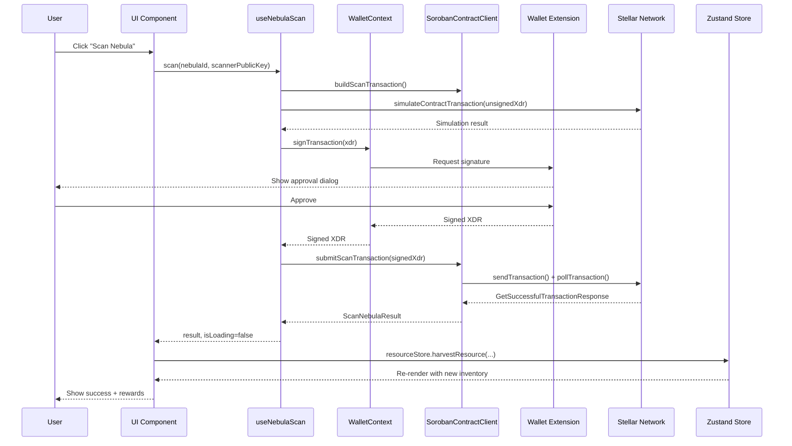

# Data Flow: Scanning a Nebula

Sequence diagram for the application's main on-chain action — scanning a nebula
zone for resources — from the user's click through wallet signing to the
on-chain confirmation and UI update.

Full step-by-step narration, error handling at each hop, and two more flows
(wallet connect, WebSocket live updates) live in
[`docs/DATA_FLOW.md`](../DATA_FLOW.md).
