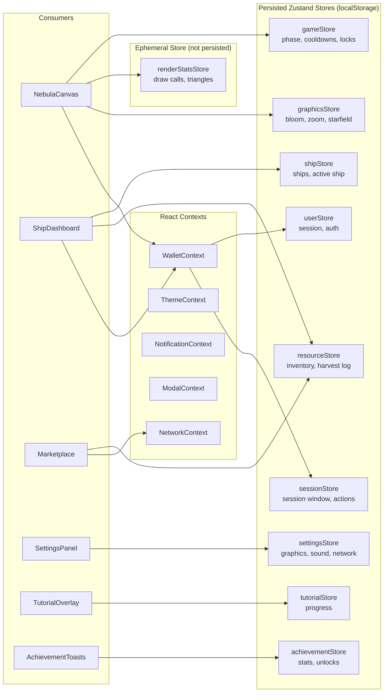

# State Management

All nine Zustand stores and five React contexts in `src/store/` and
`src/contexts/`, grouped by the kind of state they hold.

The full field-by-field breakdown of every store and context — including which
fields persist, their schema versions, and which components read them — is in
[`docs/STATE_MANAGEMENT.md`](../STATE_MANAGEMENT.md).
