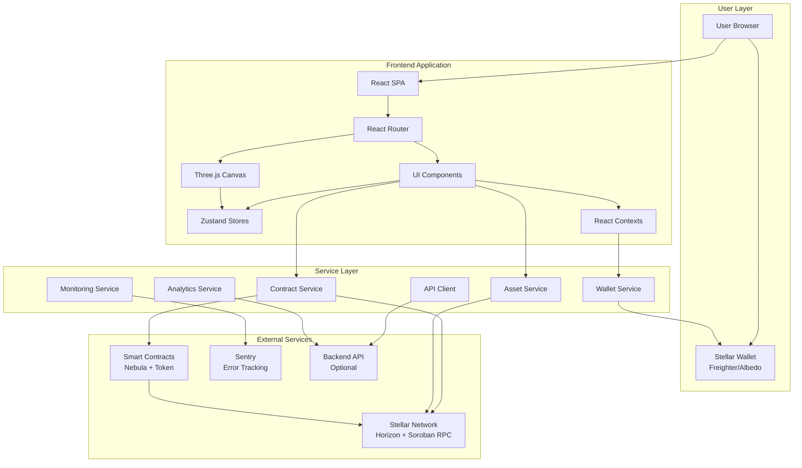

# System Overview

High-level structure of the Stellar Nebula frontend: the user's browser and wallet,
the React single-page application, the service layer that talks to the outside
world, and the external services it depends on (Stellar network, Soroban smart
contracts, Sentry, and an optional backend API).

See [`docs/ARCHITECTURE.md#system-overview`](../ARCHITECTURE.md#system-overview)
for the prose description of each layer, and
[`docs/ARCHITECTURE.md#technology-choices`](../ARCHITECTURE.md#technology-choices)
for why each technology was picked.
